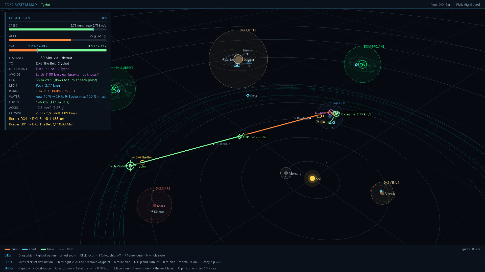
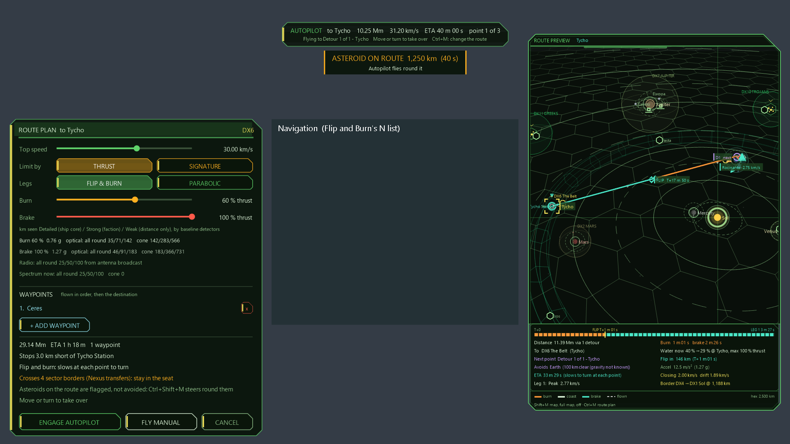
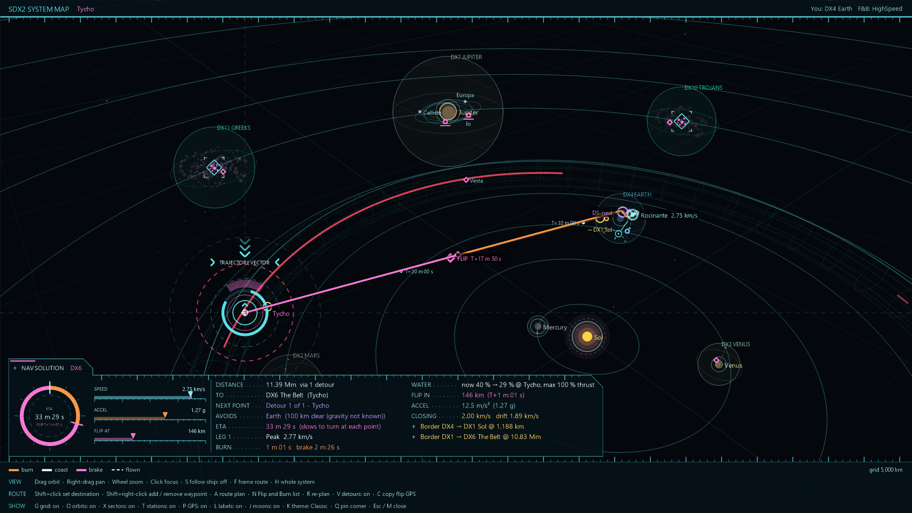

# SDX2 System Map

A standalone Pulsar client plugin: a 3D map of the Sigma Draconis Expanse 2 system that plans routes to the
destinations in **Flip and Burn's N list** and to your **saved GPS points**. A programmable-block autopilot can then fly that route. Written
from scratch.

## Summary

- **What it is:** a client-side Pulsar plugin for SDX2. It draws a 3D map of the system and plans routes to
  the destinations in Flip and Burn's N list and to your saved GPS points (no station is built into the plugin: a station is drawn,
  listed and routed to only once its GPS point, `region.place.STN`, is in your own GPS list): burn, flip and brake points, detours round planets and asteroid
  fields, sector borders, ETA and water use.
- **Where you see it:** a map window beside the N list, a full-screen map, a pinned corner view, a camera picture of
  the destination, and optionally a second monitor (with touch).
- **Flying the route:** by hand, with HUD markers that show where to point the nose and when to flip; or with the
  optional autopilot script in a programmable block on your own ship, which the plugin hands the route to through the
  block's Custom Data.
- **What it reads and writes:** it reads your own ship, your GPS list and Flip and Burn's list. It writes only to Flip
  and Burn's selection and to your own autopilot PB. Nothing is sent anywhere else.
- **When it switches off:** it does nothing in worlds without SDX2's Flip and Burn mod, and hides everything in admin
  mode and spectator. When you are AFK it is read-only: the displays stay current, but no keys, mouse, prompts or
  writes.
- **Status:** in development, not on PluginHub. Run it from this repo with `Deploy-LocalDev.ps1` (see
  [Build, test, deploy](#build-test-deploy)). `IN-GAME-TESTS.md` lists what has not yet been checked in game.

## Previews

These are drawn by the test project from the plugin's own renderer (`dotnet run -c Release --project Tests`), not
captured in game.

The full-screen map with a planned route (Classic theme):



The Route Plan beside Flip and Burn's N list, with the route preview and the autopilot's HUD lines (OPA theme):



The full-screen map in the Protogen theme:



## In game

The plugin only runs in worlds that have SDX2's Flip and Burn mod (workshop 2832248541). Elsewhere it stays off:
no keys, no map, no toolbar actions, no speed-dial fix. Only its settings window opens.

1. Sit in a cockpit and press **N**. Flip and Burn's list opens with the **map window** beside it (**Shift+M** cycles
   it: map window, full-screen map, off. M alone stays the game's symmetry key; every key can be rebound in
   [Settings](#settings)). The **Route Plan** panel stands on the list's other side; **Ctrl+M** opens the list, the
   plan and the map window in one go, with or without a destination. On a controller, **LB + Select** does the same
   and **RB + Select** opens the full-screen map (again closes it).

   **Controller in the full-screen map.** The key help at the bottom shows the controller's buttons while the
   controller is the input used last, and the keyboard and mouse ones again as soon as those are used.

   | Controller | Does |
   |---|---|
   | Right stick | moves the select cursor |
   | Left stick | moves the map |
   | RT | what the cursor is on becomes the destination |
   | LT | adds a waypoint at the cursor (on a waypoint or detour: removes it; with no route: the destination) |
   | R3 | focuses the view on what the cursor is on |
   | A | presses the button the D-pad is on (with no buttons up: focuses, as R3) |
   | D-pad | moves between the Route controls' buttons and panels |
   | X / Y | follow ship / frame the route |
   | L3 | turn with ship |
   | Start | the route plan (as the A key) |
   | RB + LB held | right stick turns and tilts the view, left stick zooms, Y re-plans, X clears the route, R3 shows the whole system |
   | B | back |

   The show toggles (grid, orbits, labels and so on), the theme and dragging a waypoint stay on the keyboard and
   mouse.

   **Controller in the Route Plan** (the N list with the map window beside it). The same buttons work on the map
   window while the cursor is over it, and its key help switches the same way. The cursor there is the N list's own
   (right stick, LB clicks); the D-pad and A work the Route Plan's buttons, B closes the list, and Start is left to
   the game.
   **Esc**, or **B** on a controller, closes what is up (the list with its Route Plan, else the map window unless
   it's pinned, or the full-screen map) and does not open the pause menu; with none of them up, Esc and B are the
   game's as usual.
2. Pick a destination: an entry in the list, or one of your saved GPS points (in the full map, or **Send to route
   planner** on the terminal's GPS tab). The list **stays open** (Flip and Burn would close it), and the map shows the route.
3. The Route Plan panel ("No destination yet" until you pick one) has **ENGAGE AUTOPILOT**, **FLY MANUAL** and
   **CANCEL**. CANCEL puts the panel away until the list is opened again or the destination changes.
   - **FLY MANUAL**: the list closes and you fly it with Flip and Burn as usual. The plugin picks each route point in
     Flip and Burn's list as you reach the one before, so F&B's box always points at where to go next. A **MANUAL**
     line on the HUD (where the autopilot's line goes) shows the destination, which point of how many, the distance,
     speed and ETA, and what F&B points at. About 30 s before a point where the route turns, it says how far
     (`Turn 35° at Waypoint 2 for Hygeia in 20 s`): F&B plans to stop at each point it's given, so you know the next leg
     is coming. Taking over from the autopilot (STAY MANUAL, or STOP AUTOPILOT) starts it too, on the
     rest of the route. Picking another destination, ENGAGE AUTOPILOT or arriving ends it.
     While it's on, two markers show where to point the nose: a small ring where your nose points (first or third
     person) and a diamond where it should, labelled **BURN** (along the route's line toward the next point),
     **BRAKE** (back along it, after the flip) or **CORRECT** (coasting, but drifting off the line). If you're off the
     line or drifting across it, the diamond is tilted (up to 45°) so the burn brings you back onto it. Put the ring on
     the diamond; it turns green within 2°. Under the label a countdown says what comes next: `COAST in 1 m 20 s` or
     `FLIP in 45 s` while burning (the hand-flown plan has a pilot's slack: it calls the flip 6 s of travel earlier
     than the autopilot would and counts on 85% of the braking thrust, so a slow flip or a soft brake still stops in
     time), `FLIP in …` while coasting, and `TURN for Hygeia in 30 s` or `ARRIVE in 30 s` while
     braking. Off the screen, an arrow on the edge points the way. The markers, their label tab and the
     MANUAL line follow the map theme (K in the full map): a diamond on the Classic chart, a corner-bracket lock on
     Tachi, an octagon lock with a gold pip on UNN, a hazard triangle on Belter, a lock reticle on Protogen and a bracketed
     contact on OPA, each with its own nose marker. **Burn guide** in the settings window (`BurnGuide`) turns them
     off. **Nose marker for the crosshair** (`HideCrosshair`, off by default) hides the game's crosshair whenever
     you're in a seat, first person or third, and shows the theme's nose marker where the ship really points instead
     (in third person the crosshair sits at the screen's centre, which isn't where the nose is). The label also gives
     the thrust to use: `BURN 80%` (the plan's share of full thrust) or `BRAKE 64%` (what stops the ship on the point),
     and where the ship stops: `overshoot 3.2 km` or `short 850 m` from how hard it's slowing now while braking (or
     `stops on the mark`), and `overshoot …` before the flip when even full thrust can't stop in time. A fainter
     **NEXT** mark shows where the nose goes at the next change, with its time: `NEXT FLIP 1 m 20 s` (straight back
     along the line) while burning or coasting, `NEXT TURN 30 s` (along the next leg) while braking for a route point;
     off the screen it's an arrow on the edge pointing the way to turn. The markers
     hide while the terminal, the full map or another menu is open.
   - FLY MANUAL flies the route as set up in the panel, waypoints included. While the autopilot flies, the AUTOPILOT FLYING card (and the row under the N
     list) has **STOP AUTOPILOT**, **FLY MANUAL** and **FULL STOP**: FLY MANUAL lets go at once, with no pop-up, and keeps
     the route for the burn guide (RESUME ROUTE hands it back).
   - **ENGAGE AUTOPILOT** (needs the autopilot script in a PB on the ship) hands the plan to the autopilot. See
     [Autopilot](#autopilot).

### Your ship on the map

Your ship is drawn as a top-down silhouette of its SDX2 core class, with drive bells on its stern, turned the way the
ship faces (the Barge and Hauler lead with their square cargo blocks). The silhouette gets
shorter along its nose as the nose turns toward or away from the view. There is one silhouette for each class:
Skiff (no core), Barge, Hauler, Picket, Corvette, Frigate, Cruiser, Battleship, Carrier, Dreadnought, Outpost,
Installation and Station Admin. Bigger classes draw bigger.

Out from the icon, a trajectory marker shows where the ship is actually going (its velocity), so a ship flying
backwards or drifting sideways shows both. Each theme has its own marker:

| Theme | Trajectory marker |
|---|---|
| Classic | plain arrow |
| Tachi | segmented line ending in a double chevron |
| UNN | plotting vector with ruler ticks and a gold diamond |
| Belter | run of hazard chevrons |
| Protogen | thin line to a small crosshair reticle |
| OPA | dotted trail ending in a triangle |

**Ship icon: From Current Ship** (settings, Look page) makes the icon from the blocks of the ship you are flying, with
the nose along the Ship Core's forward (with no core: against the first fusion drive's flame). **Flip** steps through
its four sides (top, right side, bottom, left side) and the picture under it shows the icon as it will draw. Until you
flip, the side is the top or the right, whichever looks down the ship's thinner dimension. The icon follows the ship
as you build on it. `Core/ShipSamples.cs` still holds silhouettes sampled from ships in the SDX2 creative save
(`python Tools/ship-silhouettes.py "<save folder>"`); the tests draw them, the map no longer uses them.

**Settings for: Each ship / All ships** (bottom left of the settings window). With **Each ship**, every ship you sit
in keeps its own settings (keys, look, colours, icon side, route limits and the rest) in
`Storage\SDX2_SystemMap_Ships\<ship name>.ini`; a ship seen for the first time starts from the set for all ships, and
on foot the last ship's settings stay in use. **All ships** makes the settings on screen the one set used everywhere;
the ships' own files stay on disk and come back when you switch to **Each ship** again. Ships are told apart by
name, so two ships with the same name share their settings and a renamed ship starts afresh.

**Terminal GPS tab:** **Send to route planner**, beside **Copy to clipboard**, makes the selected GPS the route's
destination (as Shift+click on it in the full map).

Everything is kept in `%AppData%\SpaceEngineers\Storage\SDX2_SystemMap.ini` (the set for all ships; each ship's own is a file of the same form in `Storage\SDX2_SystemMap_Ships`):
- `KeyMap` (`Shift+M`), `KeyAutopilot` (`Ctrl+M`), `KeyPin` (`Alt+M`), `KeySteer` (`Ctrl+Shift+M`), `KeySettings`
  (`Ctrl+Alt+OemQuestion`, which is Ctrl+Alt+/; it opens Pulsar's "Configure a plugin" list, where you pick the map, and closing the map's settings goes back to that list), `KeyCursor` (`F2`, held; extra Ctrl/Shift/Alt are fine): Ctrl/Shift/Alt plus a game key name, a side mouse button (`Mouse 4` / `Mouse 5`, stored as
  `ExtraButton1` / `ExtraButton2`), or `None`. A key fires only with
  exactly its modifiers. In the window, click a key and press the new keys (Esc or controller B cancels, Backspace unbinds); a combo
  already in use moves over and the other action is unbound. If the keys are also one of the game's controls
  (your current game bindings), a pop-up asks before binding them, the key shows **(!)**, and each world load shows a
  red HUD warning until it's rebound. A game key with no Ctrl/Shift/Alt also fires with them held, so the window notes
  that too (Shift+M also switches symmetry while you place blocks). An older file's `PreviewKey=X` becomes Shift/Ctrl/Alt/
  Ctrl+Shift+X;
- `OnlyInCockpit` (off): the map, preview, pinned map and autopilot HUD lines show, and the keys work, only while you
  sit in a cockpit, seat or remote control;
- `DefaultGridKm` (2000): how far out the map window and full map start when no route is picked, as the size of a grid
  square round your ship (50, 100, 200, 500, 1000, 2000, 5000, 10000 or 20000 km; F in the full map frames it again);
- `ShowMapWithNav` (the map window opens with the N list), `KeepNavOpen` (the list stays open on a pick);
- `ApMaxSpeed`, `ApBySignature`, `ApThrustPct`, `ApConeSignatureKm`, `ApBrakePct`, `ApBrakeConeSignatureKm` (the route
  panel's last limits; the first pair of caps is the burn);
- `PreviewLeft`, `PreviewSize` (0.5–1.5);
- `FixSpeedometer` (on): the HUD speed dial shows Flip and Burn's real speed, so it doesn't flicker to 150 m/s;
- `Pip`, `PipCorner` (`TR`, `TL`, `BR`, `BL`), `PipSize` (0.5–2): the pinned picture-in-picture map (Alt+M, Q in the full map);
- `SecondScreen` (off), `SecondScreenMonitor` (0 = the first screen that isn't the main one, else 1, 2...),
  `KeySecondScreen` (`Ctrl+Alt+M`): the [map on a second screen](#map-on-a-second-screen-touch);
- `Theme`: `Classic`, `Tachi`, `UNN`, `Belter`, `Protogen` or `OPA` (K in the full map);
- `AvoidBodies`, `AvoidFields`, `OffsetKm` (0.5–20; how far short of the destination it stops);
- `ShipIconFromShip` (ship icon from the current ship), `ShipIconSide` (`-1` auto, `0` top, `1` right, `2` bottom, `3` left), `PerShip` (on; read from the main file only);
- `AutopilotAutoSend`;
- `DestView` (on), `DestViewRangeKm` (10; 1–30), `DestViewReplacesMap` (off), `DestViewCorner` (`TL`), `DestViewSize`
  (0.5–2), `FeedNoise` (on): the [destination view](#in-game);
- `BurnGuide` (on), `HideCrosshair` (off), `NoseStyle` (`Theme` or a theme's name), `HudX`, `HudY`, `HudSize` (the
  autopilot line), `FollowHeading` (on), `KeyPanel` (`B`);
- the camera angle and the layer toggles.

## Build, test, deploy

```
dotnet run -c Release --project Tests                    # the checks + previews\full-map.png, side-preview.png, autopilot.png
dotnet run -c Release --project "PB Autopilot\Check"     # compiles the PB script as the game does (C# 6) + the flight sims
.\Deploy-LocalDev.ps1                                    # Interim (.NET 10, into Pulsar\Interim or else Pulsar\Legacy, as Pulsar does); -Edition Legacy for .NET 4.8
```

- `Core\` is game-free: maths, data, and the renderer against `IMapCanvas`, including the autopilot panels. It's what
  the tests run.
- `ClientPlugin\` holds the game side: GameCanvas, GameState, FlipAndBurnLink, AutopilotLink, AsteroidWatch,
  SidePreview, MapScreen, DestinationView, SecondScreen, Plugin.
- `PB Autopilot\` holds the PB script. Its guidance (`Program.Nav`) makes no game calls, so the check project flies it
  in point-mass sims: straight hops, the 50 km/s cap, a detour, early and late asteroid dodges, a slow-turning ship,
  and gravity.

Client plugins on SDX2 must come from Pulsar or be approved by staff: ask in #sigma-support before using it there.
